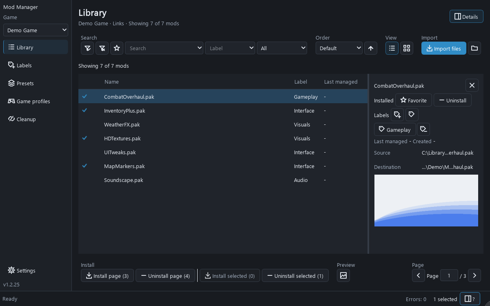

# Mod Manager

A symlink-based mod manager for Unreal Engine games and most other engines, supports both copy or symlink-based mods.
- Manages mods as symbolic links (files) and junctions (folders) in the game directory — no file copying.
- Supports copy based installation so the games that rejects symlink based mods will work without issues.

---



---

<details>
<summary>Running from source</summary>


## Quick Start

```bash
# Install GUI, completion and development dependencies
pip install -r requirements.txt

# Prepare archive support (requires internet on the first run)
python build-gui-exe.py --prepare-only

# Launch interactive text UI
python mod-manager.py

# Launch GUI
python mod-manager.py gui
```

> **Windows note:** Directory junctions do not require elevation. For file symlinks, Administrator rights may be needed if the account lacks the *Create symbolic links* privilege — this can be avoided by enabling [Developer Mode](https://learn.microsoft.com/en-us/windows/apps/get-started/enable-your-device-for-development).

> **File system support:** exFAT and FAT32 destinations cannot store symbolic links or junctions. Use **Games → Edit → Install method → copy**, or a destination with link support such as NTFS. Administrator rights and Developer Mode do not add link support to exFAT or FAT32.

---

## Build GUI Executable

Builds prepare the pinned 7-Zip resources automatically. The first preparation
requires internet and Windows tar; later builds reuse verified local files.
To prepare resources without building, run `python build-gui-exe.py --prepare-only`.
Packaged applications include these resources and work offline.

<details>
<summary>Onedir app (recommended — faster startup)</summary>

```powershell
python build-gui-exe.py --exe --onedir --no-clean-before
# Output: dist\mod-manager-gui\mod-manager-gui.exe
```

The build script checks for required GUI/build packages and, in an interactive shell, asks whether missing packages should be installed.

</details>

<details>
<summary>Onefile app (single executable, slower startup)</summary>

```powershell
python build-gui-exe.py --exe --onefile --no-clean-before
# Output: dist\mod-manager-gui.exe
```

</details>

<details>
<summary>Portable Python archive (no PyInstaller)</summary>

```bash
python build-gui-exe.py --pyz
# Output: dist\mod-manager-gui.pyz
```

</details>

`--no-clean-before` keeps the other build format when creating a new one. Without it, the builder removes previous formats. Rebuilding can replace the selected output folder; keep valuable application data outside build outputs.
</details>

---

<details>
<summary>Features</summary>

---

- Install / uninstall mods via symlinks — no file duplication
- Per game profile install method: links, or physical file copies for games that reject linked files
- Overwrite confirmation before a copy install replaces files already in the game folder
- Group several file types into one mod, for example `.pak` + `.utoc` + `.ucas` sharing a name; the detail panel lists every file of the group
- Game profiles with separate game folders, source folders, presets, labels, and active default selection
- Presets — save and restore named mod sets
- Labels — assign several manual labels to a mod, or automatically match labels by name fragments
- Profile-scoped favorites — star mods independently from labels and combine the favorite, label, and search filters
- Pagination, search, and ordering; filter suggestions use the complete library and show full names on hover
- Combine search, labels, favorites and **All / Installed / Not installed**. Active filter chips can be removed individually; the result count includes the complete library before filtering.
- Separate **Install selected / Uninstall selected** and **Install page / Uninstall page** actions show how many mods will change. Page actions affect only the current filtered page.
- Preset actions open a review of installations, removals, unchanged entries and missing mods before applying changes. Shared mods follow the displayed preset order; unrelated mods keep their current state.
- Archive import shows the future folder tree and the combined selection from all archives. Review the final destinations after resolving name conflicts and before importing.
- Background operations display their stage and available item progress, followed by success, skipped and failure counts. Import failures join the session error history.
- Empty library results explain whether to import mods, clear filters or correct a game profile's folder paths. Narrow library layouts can scroll while keeping the active game and installation method visible.
- Combine search, labels, favorites and **All / Installed / Not installed**. Active filter chips can be removed individually; the result count includes the complete library before filtering.
- Separate **Install selected / Uninstall selected** and **Install page / Uninstall page** actions show how many mods will change. Page actions affect only the current filtered page.
- Preset actions open a review of installations, removals, unchanged entries and missing mods before applying changes. Shared mods follow the displayed preset order; unrelated mods keep their current state.
- Archive import shows the future folder tree and the combined selection from all archives. Review the final destinations after resolving name conflicts and before importing.
- Background operations display their stage and available item progress, followed by success, skipped and failure counts. Import failures join the session error history.
- Empty library results explain whether to import mods, clear filters or correct a game profile's folder paths. Narrow library layouts can scroll while keeping the active game and installation method visible.
- Broken link detection and cleanup
- GUI (PySide6/Qt) and CLI interfaces
- The GUI sidebar opens Library, Labels, Presets, Game profiles, Cleanup, and Settings in the main window. Use the game selector to switch profiles; in narrow windows the sidebar uses icons with hover tooltips.
- **Labels** lists the active game's labels, their modes and matching mod counts. Narrowing the list shows only a mode icon and mod count; hover for the full label details. Select a label to rename it, choose **Manual** or **Automatic**, and inspect matching mods. Manual mode uses checked mods. Switching modes retains both sets of choices.
- **Automatic** matches any name fragment, ignoring letter case. Numbered fragment chips wrap to the available width and scroll after four rows. Click a chip or its pencil to edit; click the pencil again or press Enter to confirm, and use its trash icon to remove it. Add fragments beside **Name fragments** and press Enter to start another. Chips display up to 32 characters; hover for the full text, which remains saved and editable. The matching table shows every matching fragment number; numbers update after deletion. New matching mods join automatically when the library refreshes.
- Labels, fragments and manual assignments save automatically after a 600 ms pause, including input entered without pressing Enter. Duplicate or empty label names and invalid fragments remain editable without overwriting saved values. Automatic labels need at least one fragment. Pending valid changes save before switching profiles or closing; invalid drafts remain separate for each profile during the session. Write errors offer retry, and conflicting edits can be resolved by reloading saved labels. Existing single-label data remains supported.
- Mod details provide actions to create or assign a label. Each manual label has a removal icon; automatic labels have an edit-rule icon. With several mods selected, labels show membership counts and removal affects only selected mods. Clicking a label name filters the library. Label removal and management are available through details rather than the context menu.
- **Search** and **Label** buttons reveal one shared filter input. Press Enter, Tab to complete a suggestion, or choose a suggestion to add a filter chip. Close the input with its cross or Escape; applied chips and unfinished text are retained. Dropdowns and suggestions fit within the screen. Pagination and installation actions stay at the bottom of Library.
- Preset reviews show each operation above a status/name/extension table, without preset names, using one shared scrollbar. Archive destination trees remain fully expanded.
- The **Details** button shows or hides the selected mod's information beside both list and tile views. Visibility and panel width are remembered between launches.
- Right-click a mod in the list or tile view for an icon menu with install/uninstall, favorites, labels, preview image, Explorer locations, and details actions. Right-clicking a selected mod targets the whole selection; right-clicking another mod targets only that mod. Opening or dismissing the menu preserves selection. **Show details** is always available, including when the details panel is hidden. Close the panel with its close button or the **Details** header button.
- Settings keep unsaved edits while you move between pages. **Save** applies them; **Reset changes** restores the saved values. Closing the application discards unsaved edits.
- **Settings → Interface animations** enables smooth hover transitions, Material-style waves from the click point within button borders, and transitions for navigation, details, progress and application dialogs. Click waves adapt to the button background in both themes. Save applies the choice immediately; disabling it settles running transitions.
- Library scans and preview decoding run in the background. Tile previews load three rows above and below the visible area. Search, filters, sorting and pagination reuse the loaded library; applying mods also reuses loaded artwork. **F5** in Library reloads files and artwork. Applying or removing mods animates their rows or tiles and the selected details into a circular indicator, then shows a check for success or a cross for failure before restoring the content. Preset rows use the same feedback. Installation actions remain unavailable until the operation, library refresh and feedback finish. A short moving line below the status bar indicates background work without shifting the page. Results and errors appear in the status bar; failed refreshes keep the previous results and offer **Retry loading the library** there. The animation setting also controls filter transitions and pagination feedback.
- Settings and Labels indicate unsaved drafts in navigation. Label drafts remain separate for each game profile.
- **Settings → Keyboard shortcuts** is collapsed initially; use the centered arrow to expand it. Each field contains its command and recorded combination. Enable or disable bindings, or clear them with the field's clear button, Backspace or Delete. **Restore defaults** edits the draft; **Save** validates conflicts and applies it. Shortcuts respect text editing and modal dialogs.
- Default shortcuts include **Ctrl+F** for library search, **F5** for refreshing the current page, **Ctrl+S** for saving Settings or Labels, and **F1** for keyboard help. The help button and tooltips show the saved assignments. Existing paste, navigation and tile zoom shortcuts remain available.
- The interface currently ships in English. Language catalogs use one `strings.json` per language under `mod_manager/i18n/<language>/`; additional catalogs are discovered automatically and missing entries fall back to English. The Language setting applies after saving and restarting.
- The GUI status bar shows a clickable error count for mod operations. Open it to review failed files, full source/destination paths, and error descriptions from the current session, including batch and preset actions. History remains available across game profile changes and resets when the application closes.
- Source and destination paths in the mod details show the two nearest directories and the file or folder name, up to 100 characters. Longer text is shortened in the middle to fit; hover to see the full path or click to locate it in Explorer.
- Drag, drop, paste, or pick mod files/folders in the GUI
- Import nested ZIP, 7z and RAR archives, with a manager for choosing separate variants or adding them together
- Optional local image for mods, including assigning one preview to multiple selected mods with confirmation
- List and tile view modes in the GUI
- Tile view preview images, installed markers, keyboard navigation, and zoom
- Virtual rendering keeps off-screen mod rows and tiles from being drawn beyond a one-row buffer

---

</details>

<details>
<summary>Mod preview images</summary>

Select a mod and press **Ctrl+V** to set a copied image file, browser image, or screenshot as its preview.
Windows bitmap images copied directly by other applications are supported without additional image libraries.
With the default paste shortcut, this also works while the library search or another library text field has focus. Text-only clipboard contents paste normally.
With multiple mods selected, a confirmation shows the image and the number of previews that will be replaced.
Paste one image at a time. Without a selection, pasting an image lets you choose a mod.

**Set preview image** first offers a usable image from the clipboard, with a thumbnail.
Choose **Use image** to apply it, **Choose file...** to select another image, or **Cancel** to stop.
If no single usable image is available, the file chooser opens directly.
Applying to multiple mods always requires confirmation; accepting the clipboard offer also confirms that batch.
Preview files are stored locally in the source folder's `images` directory. Original image files are preserved.
In the details panel, previews automatically fit the space below the mod information, including enlarging small images, while preserving their proportions and showing the whole image.

</details>

<details>
<summary>Importing archives and mod options</summary>

Drop or paste archive files into the application, or select them with **Import mod files**.
On Windows, files and nested folders copied or dragged from an archive opened in Explorer are also supported.
ZIP, 7z and RAR files can contain mods at any folder depth; a separate 7-Zip installation is unnecessary on Windows x64.

One archive with one mod imports automatically using your defaults. Multiple mods or archives open the import manager:

- With multiple archives, use the compact, full-width row of filename buttons. The mouse wheel over the row switches archives; **←/→** does the same while the row has focus. Overflowing buttons scroll into view. Names stay centered on hover and show up to 32 characters, with the full name available in a tooltip. For a single archive, the row is hidden and its filename appears above the import options.
- **Add files together** creates one mod folder named after the archive. Turn it off to choose individual mods with checkboxes. Configured related file types stay together as one option.
- **Preserve archive folder structure** keeps the original paths. Without it, files are flattened. Separate mode with preserved structure creates a folder for each selected mod.
- In separate mode, select a mod and paste an image, or drop an image onto its row. Dropping an image elsewhere in the import window assigns it to the selected mod.
- **Add** imports the choices across all archives. **Cancel** discards the prepared import. Existing names offer **Replace**, **Keep both** with numbered names, or **Skip**.

Settings → **Import** controls the default mode (together), structure preservation (off), and ignored extensions (initially empty).
The ignored list accepts comma-separated values such as `.txt,.md` and applies to files, folder contents, and archives during import.
Explicitly assigned preview images are independent of that filter. Importing never deletes the original archives or source files.

Imported folder mods remain visible even when a profile's file filter contains only `.pak`.
Folder mods install under their own folder name using the profile's link or copy mode.
Password-protected archives and archive links are unsupported; errors identify the affected archive.
Archives inside other archives are not unpacked recursively.

</details>

<details>
<summary>Extra details</summary>

---

<details>
<summary>Requirements</summary>

- Python 3.10+
- [PySide6](https://pypi.org/project/PySide6/) >= 6.7 — Qt 6 bindings for the GUI (LGPL v3)
- [prompt_toolkit](https://pypi.org/project/prompt_toolkit/) — for interactive CLI tab-completion
- [PyInstaller](https://pypi.org/project/pyinstaller/) — only needed to build a standalone executable

Install all at once:

```bash
pip install -r requirements.txt
```

> **Note:** PySide6 is distributed under the LGPL v3 license. When distributing a built executable, the Qt dynamic libraries must remain replaceable in accordance with the LGPL terms.
</details>

---

<details>
<summary>Data Files</summary>


- `config.json` stores application settings and game profile definitions.
- `profiles/<profile-id>-presets.json` stores named mod sets for each game profile.
- `profiles/<profile-id>-labels.json` stores labels plus last-managed metadata for each game profile.
- `profiles/<profile-id>-imports.json` records explicitly imported folder mods, scoped to their source directory (`default-imports.json` when no profile is active).
- `labels.json` also stores the reserved `__favorites__` map, keyed by game profile ID; existing flat label records remain supported.
- Existing global `presets.json` and label records remain supported when no game profile exists.
- `<mods_source_dir>/images` stores optional mod image and is not treated as a mod folder.
</details>

---

<details>
<summary>CLI, Extra details</summary>

## CLI Reference

All commands follow the pattern: `python mod-manager.py <command> <subcommand> [args] [flags]`

CLI and GUI share game profiles, settings and mod state. Launch the GUI directly
with `python mod-manager-gui.py`, or use the `gui` command. Ordinary CLI commands
do not require Qt; interactive completion is optional.

### Getting started and checking configuration

```bash
python mod-manager.py doctor
python mod-manager.py games add "My Game" --mods-source-dir "D:/Mods/MyGame" --game-mods-dir "D:/Games/MyGame/Mods"
python mod-manager.py games prepare
python mod-manager.py games prepare --create-dirs
python mod-manager.py mods list
```

`doctor` checks the active profile, paths, stored metadata and optional components
without changing files. `games prepare` lists the folder status; only
`--create-dirs` authorizes creating missing folders. Source and game mods folders
must be separate and must not contain each other. Listing and opening folders do
not create them. Presets can be listed and deleted before paths are ready;
`[?]` means their installation state is unavailable.

Missing configuration starts with defaults. Invalid configuration or metadata is
reported without replacing the file. Correct the reported value or permissions
and retry. Exit codes are `0` for success, `1` for configuration or operation
failures, `2` for invalid arguments, and `130` for interruption. Partial operation
failures return a nonzero code and show the affected items on stderr.

### Interactive navigation

Run `python mod-manager.py` without arguments to open the menus. Each section
shows the active game, an **Items** list marked with `#` numbers, and separate
**Actions**, one per line. Enter an action number first; the application then
asks for the item number or value needed by that action.

For example, to edit game #1:

```text
Items
  #1 [*] My Game

Actions
  1) Add a game
  2) Edit a game
  3) Delete a game
  4) Select the active game
  5) Prepare folders
  0) Back
  ?) Help

Choose an action: 2
Enter game number to edit (1–1, for example 1), or 0 to cancel: 1
Editing: My Game (#1)
```

In Mods, use **Toggle selected mods**, **Install current page**, **Uninstall
current page**, **Search mods**, **Labels**, **Favorites**, **Sort mods**, or
**Pages**. Labels, Favorites and Pages offer their own numbered actions.
Presets and Broken links use the same action-then-selection pattern.

| Command | Action |
|---|---|
| `?`, `/help` or `/` | Explain the current menu and show shortcut examples |
| `0` | Go back; at an item-selection prompt, cancel the action |
| `/back` | Return to the previous menu; cancel an unfinished edit |
| `/home` | Return to the main menu; cancel an unfinished edit |
| `/exit` | Exit the application |
| `/next`, `/prev`, `/page N` | Navigate paged lists |
| `/refresh` | Reload the current list |
| `/clear` | Clear mod search, label and favorite filters |
| `/favorite` | Toggle the mod favorites filter |

Bare numbers now choose actions, not items. To toggle mod #1, choose
**1) Toggle selected mods**, then enter `1`, or use the explicit `/toggle 1`
shortcut. In Games, `e1`, `e 1` and `edit 1` edit game #1; `d1`, `d 1` and
`delete 1` delete it; `select 1` selects it. Enter an actual number, not the
placeholder letter N.

Other shortcuts remain available: `p2` opens page 2, `f text` searches,
`l:label` filters labels, `i` installs the current mod page, and `a` uninstalls
the current mod page. In Presets, `s "My loadout"` saves and `d 1,2` deletes.
Games offers **Prepare folders** with a confirmation before creating folders.

Settings offers **1) Edit a setting**, **2) Save changes** and **3) Discard
changes**. Choose Edit, then a field number from the grouped list. When leaving
with staged changes, choose **1) Save changes and leave**, **2) Discard changes
and leave**, or **0) Back** to keep editing. `s` also saves changes.

At selection prompts, `0` cancels and returns one level. In text fields, Enter
keeps the current value and `/back` cancels; the text `0` remains a valid value.
Ctrl+C cancels an input or operation without saving unfinished edits; EOF exits
the session. At the main menu Ctrl+C exits with code `130`. One-shot commands
and their arguments retain their existing syntax.

Use positive indexes separated by commas, such as `1,3,5`. Duplicates are applied
once. An invalid or out-of-range index rejects the entire selection before any
change. Indexes refer to the currently displayed page: repeat the same page,
filters and order when invoking a separate command. `install` and `uninstall`
operate on the entire selected page; `toggle` acts only on the given indexes.

### `games` — Manage game profiles

| Subcommand | Description |
|---|---|
| `list` | List game profiles and mark the active default |
| `add <name>` | Add a profile and make it active |
| `select <profile-id>` | Select the active profile for the next launch |
| `edit <profile-id>` | Update profile name or game-specific settings |
| `delete <profile-id>` | Delete a profile |
| `prepare [--create-dirs]` | Inspect active game folders; explicitly create missing folders |

**Profile options:**

```
--game-mods-dir <path>
--mods-source-dir <path>
--mod-extensions <exts>                       Comma-separated, e.g. .pak,.utoc
--mod-group-extensions <exts>                 Comma-separated, e.g. .pak,.utoc,.ucas
--mod-recursive-scan / --no-mod-recursive-scan  Scan subfolders of the source directory
--link-prefix <text>
--install-mode link|copy                      How mods reach the game folder
```

`games add --help` prints the same descriptions shown as tooltips in the GUI's Game profile fields.

`--mod-extensions` accepts any number of comma-separated extensions (e.g. `.pak,.utoc,.ucas`). Add the special `folders` token (e.g. `.pak,folders`) to also treat subfolders of the source directory as mod units. If `--mod-extensions` is empty (the default), every file and folder is shown — this matches the previous behavior. If `--mod-extensions` is set without `folders`, subfolders are no longer treated as mods unless `folders` is included.

`--mod-recursive-scan` makes the manager search subfolders for matching files at any depth (folders that themselves qualify as mod units, per `folders` above, are not recursed into). Files found in subfolders are linked into the game folder by their own filename.

`--mod-group-extensions` joins several file types into a single mod. With `.pak,.utoc,.ucas`, the files `Weapon.pak`, `Weapon.utoc` and `Weapon.ucas` become one mod listed as `Weapon.pak` — named after the first extension in the list that is actually present — and installing, uninstalling, or applying a preset covers every member at once. A grouped mod counts as installed only when all of its files are in the game folder; a half-installed group completes on the next install. Grouped extensions are always treated as mod files even when `--mod-extensions` does not list them, and files are only grouped with siblings in the same folder, so a recursive scan never merges two same-named mods from different subfolders.

`--install-mode` selects how mods reach the game folder. `link` (the default) creates symlinks and junctions as before. `copy` physically copies the mod files, for games that refuse to load linked content; uninstalling then deletes those copies from the game folder and never touches your source mods. In copy mode an install that would replace an existing file asks for confirmation first — the GUI shows a dialog listing the affected files, and the CLI prints them and stops unless `--overwrite` is given.

When the destination file system reports no link support, the GUI and interactive text menus offer to save `copy` in the current game profile and retry only the failed installations. Declining keeps the profile unchanged. Existing successful links and installations stay in place; replacing a conflicting file requires separate confirmation. Failed attempts remain in the GUI session error history. One-shot CLI commands never prompt or change the install method automatically: use `games edit <profile-id> --install-mode copy`, then retry the failed installations.

**Examples:**

```bash
python mod-manager.py games add "Stalker 2" --mods-source-dir "D:/Mods/Stalker2" --game-mods-dir "C:/Games/Stalker2/Content/Paks/~mods"
python mod-manager.py games list
python mod-manager.py games select <profile-id>
```

---

### `mods` — Manage mods

| Subcommand | Description |
|---|---|
| `list` | List mods on current page |
| `search <text>` | Filter by name |
| `label <text>` | Filter by label |
| `page <n>` | Go to page `n` |
| `order <mode>` | Sort order field and direction |
| `install` | Install all mods on page |
| `uninstall` | Uninstall all mods on page |
| `toggle <indexes>` | Toggle mods by index (comma-separated) |
| `label-add <label> <indexes>` | Assign label to selected mods |
| `label-remove <label> <indexes>` | Remove label from selected mods |
| `favorite-add <indexes>` | Add visible mods to favorites by index |
| `favorite-remove <indexes>` | Remove visible mods from favorites by index |

**Common flags** (for `list`, `install`, `uninstall`, `toggle`):

```
--page <n>       Page number (default: 1)
--label <text>   Filter by label
--search <text>  Filter by name
--order <mode>   Sort order
--favorite       Show favorite mods only
--overwrite      Replace existing files (copy install mode only; `install` and `toggle`)
```

Order modes: `default`, `created_date`, `last_managed`, `label`, `name`, `installed`.
Prefix any mode with `-` for descending order, for example `--order -last_managed`.
Legacy `d` and `cd` aliases still work.

**Examples:**

```bash
python mod-manager.py mods list --page 2 --search weapon
python mod-manager.py mods list --order -last_managed
python mod-manager.py mods toggle 1,3,5
python mod-manager.py mods label-add combat 2,4 --page 1
python mod-manager.py mods install --label combat
python mod-manager.py mods list --label combat --favorite
python mod-manager.py mods favorite-add 1,3 --filter-label combat
```

In the GUI, the favorite filter is the star button beside the Label filter. A filled star marks an existing favorite; an outline star appears when a mod row or tile is hovered. The page toolbars accept a page number and apply it on Enter while the field has focus.

---

### `presets` — Manage presets

| Subcommand | Description |
|---|---|
| `list` | List saved presets |
| `page <n>` | Go to page `n` |
| `save <name>` | Save current installed mods as a preset |
| `toggle <indexes>` | Apply or remove preset by index (accepts `--overwrite`) |
| `delete <indexes>` | Delete presets by index |

**Examples:**

```bash
python mod-manager.py presets save "my-loadout"
python mod-manager.py presets toggle 1
python mod-manager.py presets delete 2,3
```

---

### `settings` — View and update config

| Subcommand | Description |
|---|---|
| `show` | Print all current settings |
| `set [options]` | Update one or more settings |

**`set` options:**

```
--page-size <n>
--max-mod-name-len <n>
--max-preset-name-len <n>
--max-label-name-len <n>
--gui-theme system|light|dark
--archive-import-mode together|separate
--archive-preserve-structure / --no-archive-preserve-structure
--import-ignore-extensions <exts>            Comma-separated, e.g. .txt,.md
--gui-accent-color-mode system|custom
--gui-accent-color <#rrggbb>
--gui-text-color-mode system|custom
--gui-text-color <#rrggbb>
--gui-font-family <name>
--gui-font-size <n>
--ui-scale-percent <n>
--mod-view-mode list|tiles
--tile-size <n>
--placeholder-image-col-width <n>
```

`settings set --help` prints the descriptions shown as tooltips in the GUI, and the same validation applies to both.

Game-specific paths, extension, grouping and install settings (`mods_source_dir`, `game_mods_dir`, `mod_extensions`, `mod_group_extensions`, `mod_recursive_scan`, `link_prefix`, `install_mode`) are not application settings. They are edited only through `games add` / `games edit` and the GUI "Game profile" dialog, and a settings update never changes them. `settings show` still prints the values of the active profile.

In the GUI, the "Game profile" dialog (Games > Add/Edit) shows every per-game field, including "Grouped extensions", a "Scan subfolders" checkbox and the "Install method" selector — see the `games` command reference above for details on the `folders` token, recursive scanning, grouping and the copy install mode.

#### Settings labels and tooltips

Settings have human-readable labels, explanatory tooltips, and validated ranges in both the Settings and Game profile dialogs.

The dialog groups the settings into three compact bordered sections:

| Section | Contains |
|---|---|
| Lists | Mods per page, Max mod name length, Max preset name length, Max label length |
| Appearance | Theme, Accent colour, Text colour, Font family, Font size, Interface scale |
| Mods view | Mods view, Tile size, State column width |

Values are validated on save; an out-of-range number is reported by label, for example `Mods per page must be between 1 and 1000.`

`Interface scale` (`ui_scale_percent`) is applied through `QT_SCALE_FACTOR` at startup and needs the application restarted to take effect. `Font family` and `Font size` have a local preview in Settings and apply to the existing interface immediately after saving.

The GUI theme, accent color, and text color all apply immediately when saved — no restart needed. While set to `system`, the GUI also follows live OS theme/accent changes without restarting.

The accent color used for highlights, the installed badge, and active buttons follows the system theme by default. Set `--gui-accent-color-mode custom` with `--gui-accent-color <#rrggbb>` to override it with a fixed color.

The general text color (window, button, and tooltip text) also follows the system theme by default. Set `--gui-text-color-mode custom` with `--gui-text-color <#rrggbb>` to override it with a fixed color.

In the GUI, the Settings dialog shows a "Choose" color picker and a live "Theme preview" row for both the accent and text colors. Clicking the preview checkmark or "Aa" badge toggles that color between "system" and "custom" mode. The custom colour rows stay hidden while the matching mode is "system".

**Examples:**

```bash
python mod-manager.py settings show
python mod-manager.py settings set --page-size 20
python mod-manager.py settings set --gui-theme dark
python mod-manager.py settings set --gui-accent-color-mode custom --gui-accent-color "#0582CA"
python mod-manager.py settings set --gui-text-color-mode custom --gui-text-color "#f8fafc"
```

---

### `broken` — Broken link maintenance

| Subcommand | Description |
|---|---|
| `list` | List broken symlinks and Windows junctions in the game mods directory |
| `remove <indexes>` | Remove specific broken links by index |
| `remove --all` | Remove all broken links |

```bash
python mod-manager.py broken list
python mod-manager.py broken remove 1,2
python mod-manager.py broken remove --all
```

Cleanup checks links in the destination folder, including links whose source
mod has disappeared. Regular files, copied mods and live links are preserved.
Choose indexes or `--all`; invoking `remove` without either is an error.

---

### `open` — Open folders

```bash
python mod-manager.py open source   # Open mods source folder
python mod-manager.py open game     # Open game mods folder
```

---

### `help` — Show help

```bash
python mod-manager.py help                   # General help
python mod-manager.py help mods              # Help for mods command
python mod-manager.py help mods toggle       # Help for mods toggle subcommand
python mod-manager.py help presets
python mod-manager.py help settings set
python mod-manager.py help broken remove
```

---

### `--version` — Show app version

```bash
python mod-manager.py --version
```

The GUI window title and the text-UI menu header also display the current app version.

</details>
</details>

---

## License

This project is released under the [MIT License](LICENSE) — you are free to use, copy, modify, merge, publish, distribute, sublicense, and/or sell copies of this software with or without attribution.
